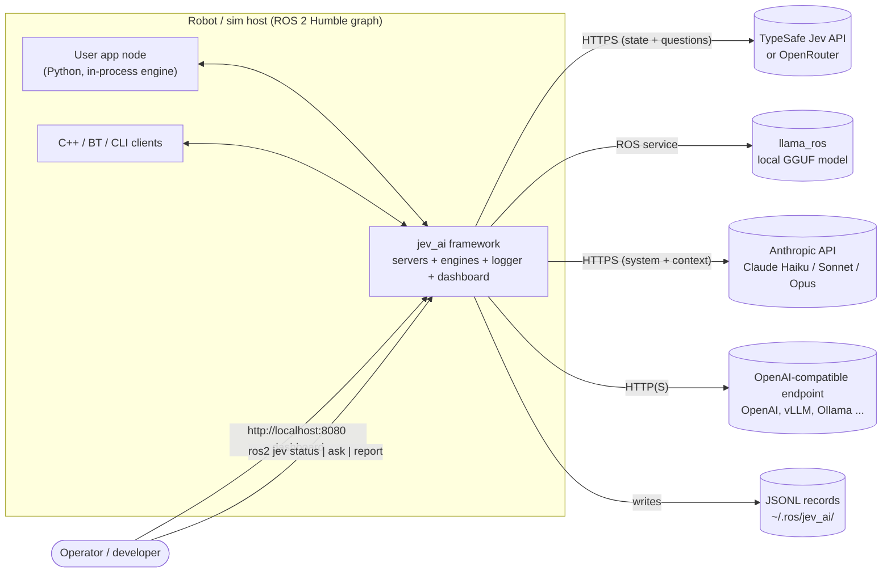
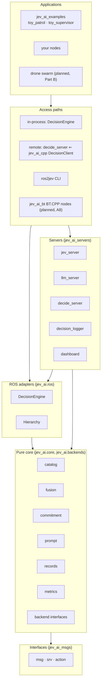
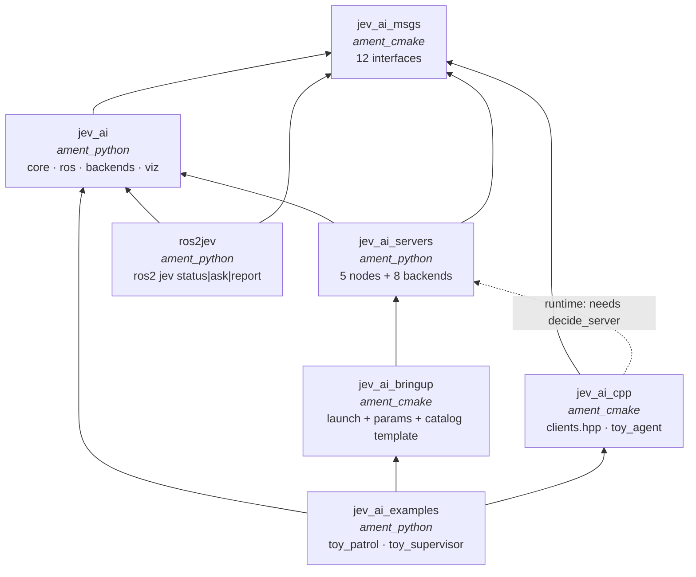
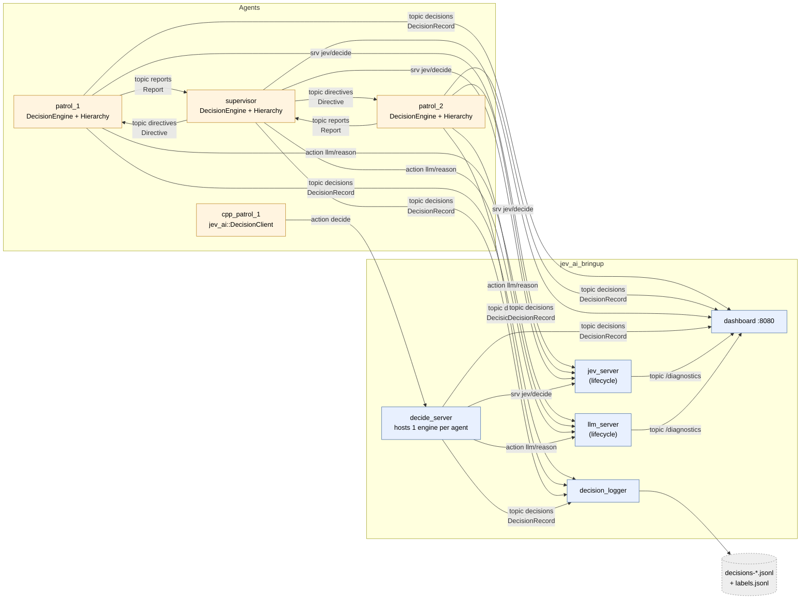
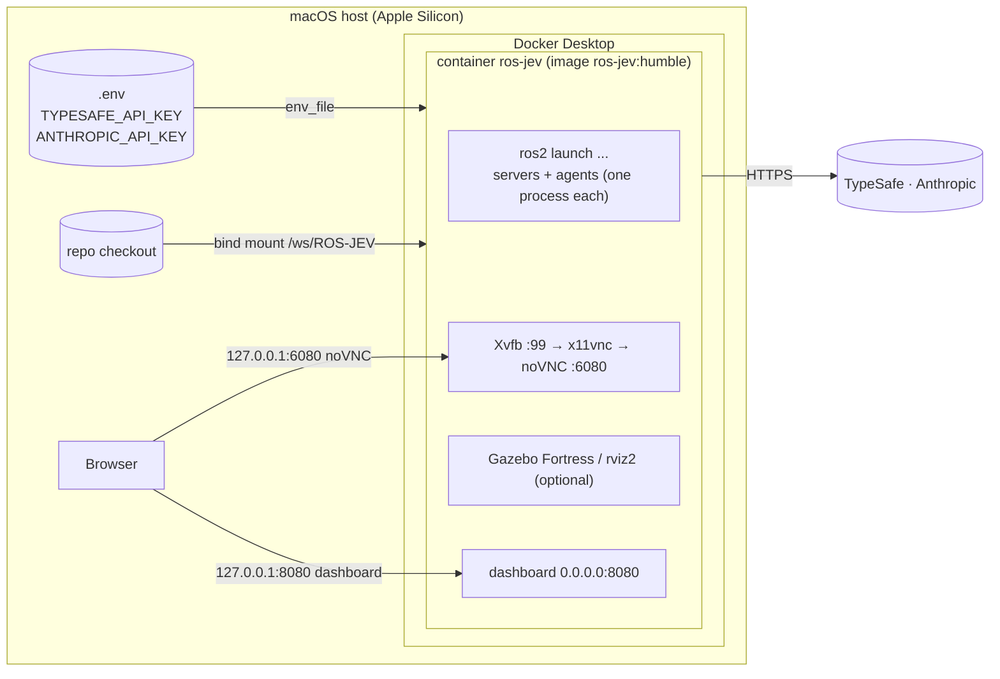
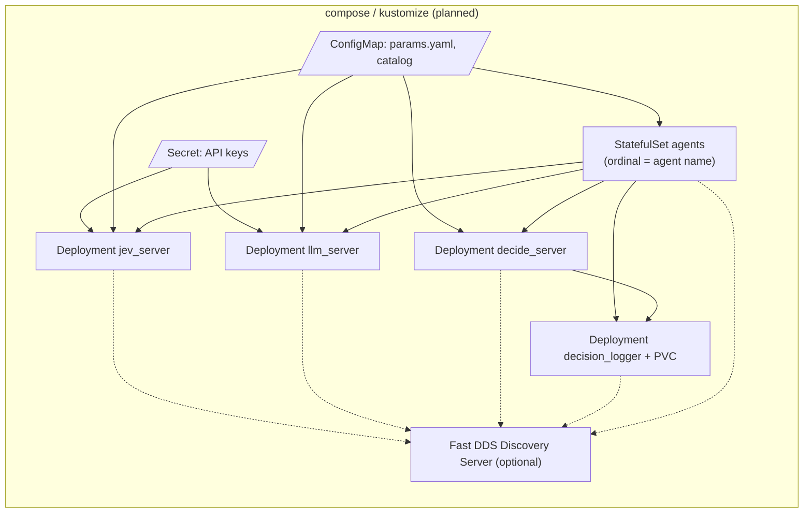

# jev_ai architecture

This page describes the `jev_ai` system as it stands after phases **A1–A7**:
- the overall architecture;
- every package and node;
- how they connect;
- where they run.

It describes the code, not the plan. [FRAMEWORK.md](../FRAMEWORK.md) is the spec and [DESIGN.md](../DESIGN.md) the roadmap. Planned parts are marked *(planned, A8+)*.

| Page | Contents |
|---|---|
| **README.md** (this page) | system context, layers, packages, the ROS graph, deployment, build status |
| [components.md](components.md) | each component's responsibilities, interfaces, parameters and internals |
| [data-flows.md](data-flows.md) | the decision cycle, commitment state machine, fusion pipeline, remote (C++) path, hierarchy, records, failures, startup |

Diagrams are Mermaid, which GitHub and most IDE Markdown previews render inline.

---

## 1. What the system does

`jev_ai` adds calibrated, LLM-augmented decisions to ordinary ROS 2 nodes. It uses two "systems":

| | System 1: **Jev** | System 2: **LLM** |
|---|---|---|
| Role | fast, typed, calibrated answer to every question | slower reasoning that *augments* Jev's answer, with bounded influence |
| ROS shape | service `jev/decide` (`JevDecide.srv`) | action `llm/reason` (`Reason.action`) |
| Server node | `jev_server` | `llm_server` |
| Backends | `typesafe`, `llama_ros`, `mock`, `replay` | `anthropic`, `openai_compat`, `mock`, `replay` |
| Typical latency | ~100 ms | 1–6 s |

The app supplies four callbacks and the **DecisionEngine** does the rest:
- `encode_state` turns numbers into short interpreted strings;
- `mask` forbids classes;
- `require` forces a class;
- `on_decision` executes the decision.

The engine asks Jev, acts at once on a **provisional** pick, asks the LLM, then **revises or keeps** the pick using the same random noise. Every step is logged.

## 2. System context

**Data egress:** state strings and question text leave the robot for whichever live backends are configured. An air-gapped deployment uses `llama_ros` for Jev and a local `openai_compat` endpoint for the LLM; neither needs a key.

## 3. Layers

Each layer depends only on the layers below it. The decision maths (`jev_ai.core`) is pure Python with **no rclpy**, so it is unit-tested and golden-vector-tested without ROS.

## 4. Packages

| Package | Status | Contents |
|---|---|---|
| `jev_ai_msgs` | A1 ✅ | `Question`, `Distribution`, `ClassRef`, `Decision`, `QuestionTrace`, `DecisionRecord`, `Report`, `Directive`, `Label`; `JevDecide.srv`; `Reason.action`, `Decide.action` |
| `jev_ai` | A2, A5, A5.5, A7 ✅ | `core/` (catalog, fusion, commitment, prompt, records, metrics) · `ros/` (`DecisionEngine`, `Hierarchy`, `run`) · `backends.py` (plugin interfaces) · `viz/` (dashboard HTML, static report) |
| `jev_ai_servers` | A3–A6 ✅ | `jev_server`, `llm_server` (lifecycle, on a shared `BackendServer` base), `decide_server`, `decision_logger`, `dashboard`; built-in backends |
| `jev_ai_cpp` | A6 ✅ | header-only API `jev_ai/clients.hpp`: `DecisionClient`, `JevClient`, `ReasonClient`; component `jev_ai_cpp::ToyAgent` |
| `ros2jev` | A5 ✅ (partial) | `status`, `ask`, `report` built; `calibrate`, `replay`, `ope`, `search` planned (A10) |
| `jev_ai_bringup` | A5 ✅ | `bringup.launch.py`, `params.yaml`, `catalog_template.yaml` |
| `jev_ai_examples` | A5, A6, A7 ✅ | `toy_patrol` (Python), C++ toy agents, `toy_supervisor`; `turtlesim` planned (A9) |
| `jev_ai_bt` | planned (A8) | BehaviorTree.CPP v4 nodes `JevAsk`, `Decide`, `Reason` |
| `deploy/` | planned (A11) | per-node images, compose, kustomize |

## 5. Runtime ROS graph

This is the graph `ros2 launch jev_ai_examples toy_patrol.launch.py agents:=2 cpp_agents:=1 supervisor:=true` brings up. Names are relative and resolve to `/` here.

| Endpoint | Kind | Type | Producer → consumer | QoS |
|---|---|---|---|---|
| `jev/decide` | service | `JevDecide` | engines → `jev_server` | default |
| `llm/reason` | action | `Reason` | engines → `llm_server` | default |
| `decide` | action | `Decide` | C++/BT/CLI → `decide_server` | default |
| `decisions` | topic | `DecisionRecord` | every engine → logger, dashboard | reliable, depth 1000 |
| `labels` | topic | `Label` | app / scorer → logger, dashboard | reliable, depth 1000 |
| `reports` | topic | `Report` | workers → supervisor | best-effort, depth 50 |
| `directives` | topic | `Directive` | supervisor → workers | reliable, volatile, depth 50 |
| `/diagnostics` | topic | `DiagnosticArray` | `jev_server`, `llm_server` (1 Hz) → dashboard, `ros2 jev status` | default |

## 6. Deployment

### 6.1 Today: one container

Everything runs as processes in a single Ubuntu 22.04 container, `ros-jev:humble`. The image contains:
- ROS 2 Humble, Gazebo Fortress and the live-backend SDKs;
- Xvfb, x11vnc and noVNC for GUIs.

- Both ports are published on the host's **loopback only**. The dashboard has no auth, so it binds `0.0.0.0` inside the container only because of that.
- Keys come from `.env` through `env_file`. They are never ROS parameters, because ROS parameter services are open to every peer.
- Server parameters are read-only after launch.

### 6.2 Planned (A11): one container per node

## 7. Design invariants

These are enforced in code; [data-flows.md](data-flows.md) shows where each one applies.

| Invariant | Where enforced |
|---|---|
| A masked class is never selected (except where `require` forces it: flagged `require_overrides_mask`) | `fusion.decide_question`: z = −∞, masks recomputed before every act |
| Irreversible classes are never sampled; they need an argmax margin on **both** fused and Jev-only logits, plus LLM augmentation, or `require` | `fusion._select`, `Commitment.on_llm` |
| An LLM timeout never commits an irreversible class | `Commitment._resolve_without_llm` → FALLBACK (the fallback is validated reversible) |
| LLM influence is bounded: \|δ\| ≤ B nats, one-sided on irreversible classes | `fusion.pool` |
| Stale or racing results are never applied | generation, Jev sequence number and mask hash checks in `DecisionEngine` / `Commitment` |
| No silent mock: a live backend without a key fails at configure | `BackendServer.on_configure` |
| Every phase transition is recorded with its noise and propensity (exact per-decision replay) | `DecisionEngine._apply` → `decisions` |
| Coupled agents share noise only when they share `run_id` and `group` | `fusion.gumbel_noise`; launch files mint one `run_id` per launch |

## 8. Build status

| Phase | Status |
|---|---|
| A1 interfaces · A2 pure core · A3 `jev_server` · A4 `llm_server` · A5 engine, logger, bringup, CLI, toy, dashboard · A5.5 metrics | ✅ on `main` |
| A6 `decide_server` + C++ clients · A7 hierarchy + supervisor | ✅ on `worktree-swarm-poc` |
| A8 BT nodes · A9 turtlesim · A10 calibrate/replay/ope/search · A11 deploy | planned |
| Part B: drone swarm ([SYSTEM_MODEL](../examples/drone_swarm/SYSTEM_MODEL.md), [DECISION_MODEL](../examples/drone_swarm/DECISION_MODEL.md)) | planned (after A11) |
