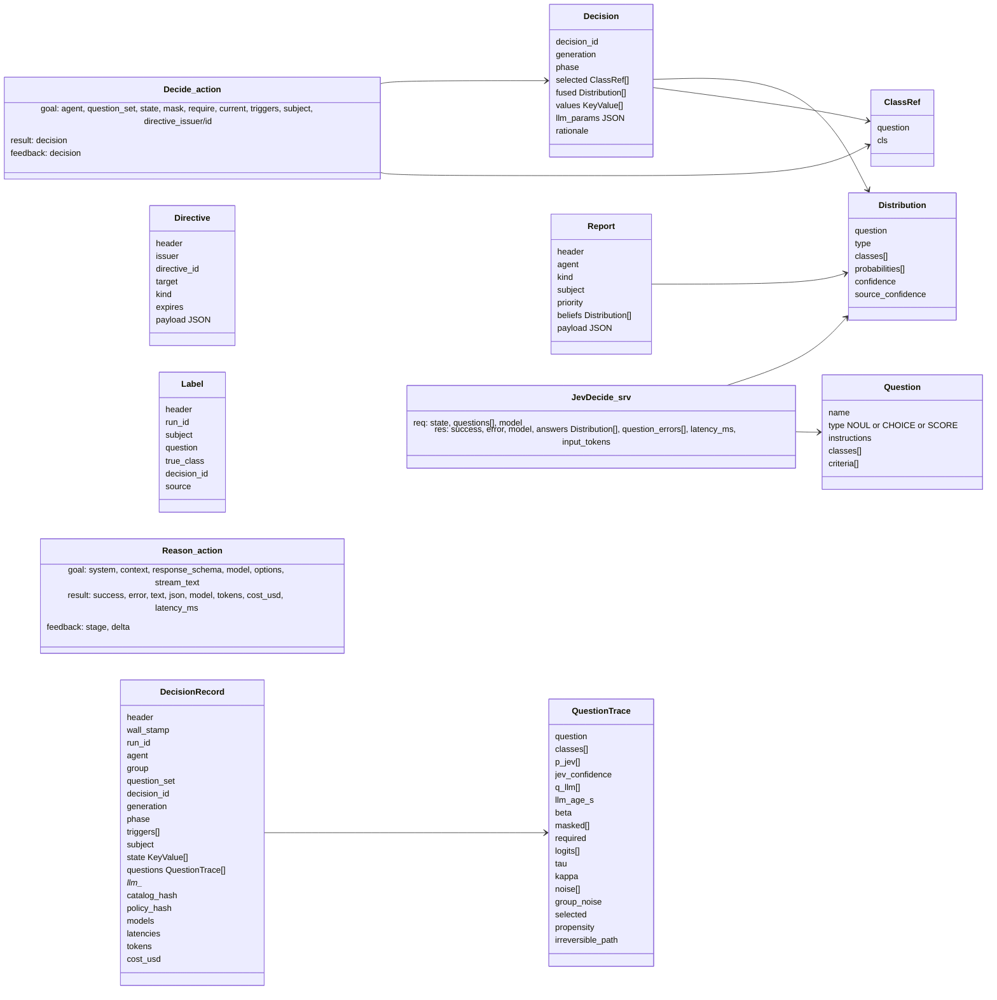
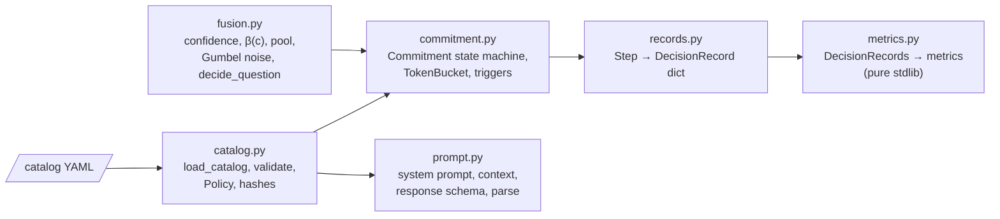
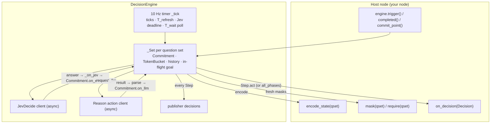
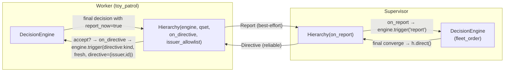
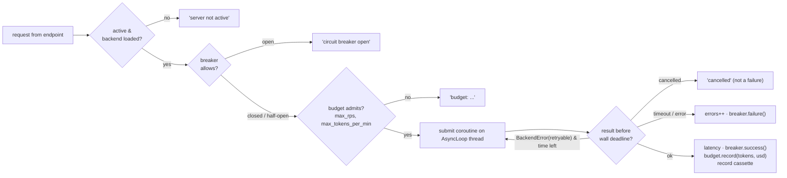
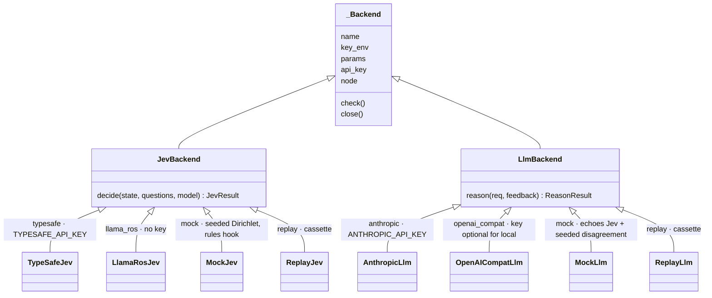
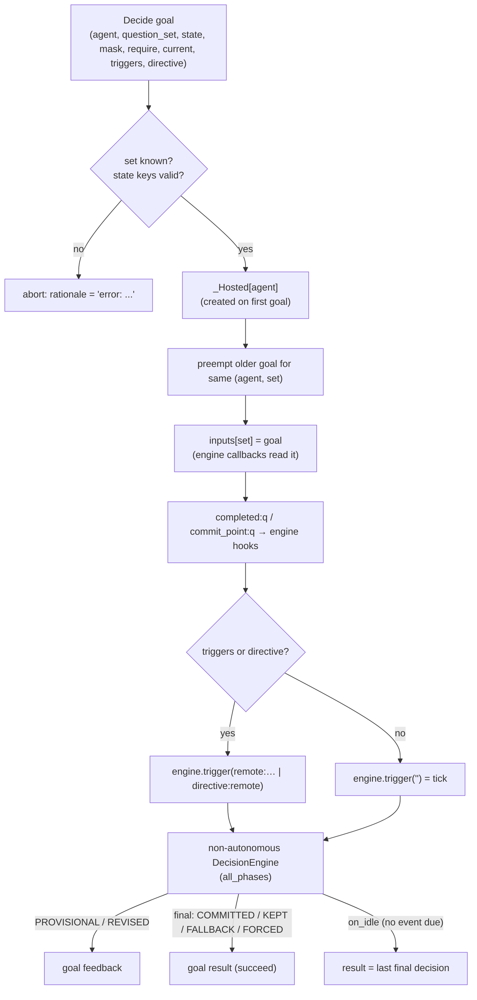
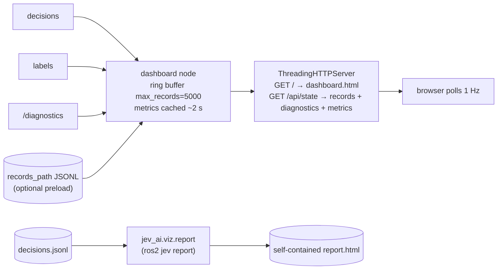

# Components

Each section covers one component:
- what it owns and what it talks to;
- the knobs that matter;
- where it lives in the code.

For the system-level picture see [README.md](README.md). For runtime sequences see [data-flows.md](data-flows.md).

- [1. Interfaces (`jev_ai_msgs`)](#1-interfaces-jev_ai_msgs)
- [2. Pure core (`jev_ai.core`)](#2-pure-core-jev_aicore)
- [3. DecisionEngine (`jev_ai.ros.engine`)](#3-decisionengine-jev_airosengine)
- [4. Hierarchy (`jev_ai.ros.hierarchy`)](#4-hierarchy-jev_airoshierarchy)
- [5. BackendServer base](#5-backendserver-base)
- [6. jev_server](#6-jev_server)
- [7. llm_server](#7-llm_server)
- [8. Backend plugins](#8-backend-plugins)
- [9. decide_server](#9-decide_server)
- [10. C++ clients (`jev_ai_cpp`)](#10-c-clients-jev_ai_cpp)
- [11. decision_logger](#11-decision_logger)
- [12. dashboard and static report](#12-dashboard-and-static-report)
- [13. ros2jev CLI](#13-ros2jev-cli)
- [14. Bringup](#14-bringup)
- [15. Examples](#15-examples)

---

## 1. Interfaces (`jev_ai_msgs`)

- **`Decision`** is what an app acts on. **`DecisionRecord`** is the complete trace of one phase transition: noise, logits, propensity and hashes. It is enough to re-derive the decision exactly.
- `Decision.phase` is a string constant: `PROVISIONAL`, `REVISED`, `KEPT`, `COMMITTED`, `FALLBACK` or `FORCED`.
- Source: `src/jev_ai_msgs/{msg,srv,action}/`.

## 2. Pure core (`jev_ai.core`)

No rclpy. All of it is covered by `pytest src/jev_ai`, including golden vectors in `test/golden/vectors.json`.

| Module | Responsibility | Key API |
|---|---|---|
| `catalog.py` | Parse and **validate** the catalog: types, class counts, act/type combinations, a reversible fallback, irreversible classes only where augmented and selecting, `T_wait ≥ llm_timeout + 0.5`, coupling ∈ [0,1]. Merges `policy:` overrides. Hashes the catalog and policy for records. | `load_catalog(src, policy_overrides)`, `QuestionSet.ordered_state()` |
| `fusion.py` | §6 maths: confidence `c = 1 − H/log\|A\|`, β schedule, bounded log-linear pooling, coupled Gumbel noise keyed by `(run_id, group\|agent, question, epoch, class)`, per-question selection by `act` (sample / argmax / expectation / threshold / none), and the irreversible rule. | `decide_question(...) → Trace` |
| `commitment.py` | The act-then-revise state machine for one `(agent, question set)`: decision events, dwell, commit points, N_fail degradation, augmentation priority, and the per-engine token bucket. | `Commitment.on_event / on_llm / on_llm_failed / poll → Step` |
| `prompt.py` | LLM request: a stable `system` prompt (prompt-cached) and a per-call `context`. The context shuffles classes with a seeded order and wraps sensor data in `<untrusted>`. Also builds the JSON schema from the catalog, and parses and clamps the response. | `system_prompt`, `context`, `response_schema`, `parse_response → Advice` |
| `records.py` | `Step` → a DecisionRecord-shaped dict, and NaN-safe JSON. | `record_dict`, `dumps` |
| `metrics.py` | Records → phase mix, revision and fallback rates, LLM agreement and influence, confidence, switch rate, latency, cost, coupling and calibration. | `compute(records, labels)` |

`jev_ai/backends.py` holds the pure **plugin interfaces** (`JevBackend`, `LlmBackend`, request and result dataclasses, `BackendError(retryable)`) and the entry-point loader.

## 3. DecisionEngine (`jev_ai.ros.engine`)

The **one** engine implementation. It attaches to any rclpy node, either in-process or hosted by `decide_server`.

- **Constructor:** `DecisionEngine(node, catalog, encode_state, mask=None, require=None, on_decision=None, on_degraded=None, jev='jev/decide', llm='llm/reason', group=None, run_id=None, agent=None, policy=None, current=None, autonomous=True, all_phases=False, on_idle=None)`.
- **Concurrency:** one `ReentrantCallbackGroup` and one `RLock` per engine. All calls are async (`call_async`, `send_goal_async`), so the engine never blocks the executor.
- **Staleness guards:**
  - `jev_seq` drops late Jev answers;
  - `generation` drops LLM results for superseded decisions;
  - the mask hash drops LLM results when masks changed in flight.
- **Coalescing:** while a Jev call is in flight, new ticks and triggers queue on the set and ride the next answer.
- **Modes:**
  - `autonomous=True`: ticks at `tick_hz`, a `start` trigger and periodic refresh.
  - `autonomous=False` (decide_server): decides only on `trigger()`. `trigger('')` is a *tick*, which decides only if an event is due and otherwise calls `on_idle`.
  - `all_phases=True` also delivers non-acting `KEPT`/`COMMITTED` steps (`Decision.act == False`).
- **Degradation:**
  - no `llm_server`, or it rejects or fails: δ ≡ 0 (Jev only);
  - no Jev: keep the current class, then FALLBACK after `N_fail` consecutive failures (`on_degraded` is called).
- `run(make_node)` is the shared entry-point body: a MultiThreadedExecutor with clean double-Ctrl-C handling.

## 4. Hierarchy (`jev_ai.ros.hierarchy`)

Optional. Reports go **up**, directives come **down**, and coordination needs no direct messages between workers.

- **Acceptance filter:** a directive is dropped, with a counter in `Hierarchy.dropped`, when:
  - `target` is not this agent or `*`;
  - the issuer is not in `issuer_allowlist` (empty = any);
  - it has expired on the node clock;
  - it duplicates an `(issuer, id)` already seen.
- **Coupling:** an accepted directive is a decision event whose noise **epoch is the directive** (`d:<issuer>:<id>`), with ρ = `coupling_directive` (default 1.0). All workers in a group that answer the same directive therefore draw identical Gumbel noise.

## 5. BackendServer base

`jev_ai_servers/base.py`. A lifecycle node shared by `jev_server` and `llm_server`, so keys, budgets, breaker, deadlines, retries, diagnostics and the record cassette are implemented once.

| Parameter | Default | Note |
|---|---|---|
| `backend` | `typesafe` / `anthropic` | entry-point name |
| `model` | `''` | `''` = the backend default |
| `api_key_file` | `''` | otherwise the env var named by the backend's `key_env` |
| `timeout_s` | 1.0 (Jev) / 6.0 (LLM) | wall-clock deadline for the whole call, retries included |
| `max_retries` | 1 | only for `retryable` errors |
| `max_rps`, `max_tokens_per_min` | 50, 200k | sliding windows; USD is **reported only** (no cap, prototype) |
| `breaker_errors`, `breaker_cooldown_s` | 5, 30 | consecutive failures to open; then one half-open probe |
| `record_path` | `''` | append successful answers to a JSONL cassette for the `replay` backends |
| `autostart` | true | configure + activate on boot (no lifecycle manager needed) |
| `<backend>.*` | | backend-specific, e.g. `mock.seed`, `typesafe.base_url` |

- All parameters are **read-only after launch**: the set-parameters callback rejects changes.
- `/diagnostics` is published at 1 Hz with backend, model, breaker state, calls, errors, p50/p95 latency, `tokens_last_min` and `usd_last_hour`.

## 6. jev_server

`jev_ai_servers/jev_server.py`. Serves **`jev/decide`** (`JevDecide.srv`).

- **Per-question fault isolation:**
  - each question is validated (name, type, class count, noul classes, criteria alignment);
  - each answer is normalised (finite, non-negative, sums > 0) on its own;
  - failures land in `question_errors[i]`;
  - `success = false` only if the whole backend call failed.
- **Model precedence:** request `model` → `<backend>.model` (pinned) → server `model` → backend default.
- **Confidence:** fills `Distribution.confidence` with the framework's entropy-based `c` and keeps the model's own figure as `source_confidence`.
- **Spend:** priced as input tokens × `usd_per_mtok_input` (default $0.042/Mtok).

## 7. llm_server

`jev_ai_servers/llm_server.py`. Serves **`llm/reason`** (`Reason.action`).

- **Goal acceptance:** goals are rejected immediately while inactive or while the breaker is open, so engines degrade at once instead of waiting.
- **Options:**
  - server `effort` and `max_tokens` are merged into the goal's options;
  - `max_tokens` is a **ceiling** a goal can lower but not raise.
- **Feedback:** `queued → started → first_token → streaming → done`. Text deltas are sent only when `stream_text` is set.
- **JSON validation:** with a `response_schema`, the result must parse as JSON, or the error is `response is not valid JSON` (the engine retries once).
- **Pricing:**
  - a backend may price a call itself;
  - otherwise the `pricing` table is used (longest model-id prefix match);
  - an unknown model counts as $0, with a one-time warning.
- **Cancellation:** cancelling a goal cancels the asyncio task, which closes the HTTP stream.
- **Multiple instances:** run one instance per model or effort level (e.g. Haiku `low` and Sonnet `medium`) and remap `llm/reason` per client.

## 8. Backend plugins

Both servers load backends by **entry point**: installed packages first, then the server's built-in table, so the servers also run from a source tree. A third-party package adds a backend by registering it under `jev_ai.jev_backends` or `jev_ai.llm_backends`.

| Backend | Notes |
|---|---|
| `typesafe` | `typesafe-sdk` async client. OpenRouter is the same backend with `base_url=https://openrouter.ai/api`. |
| `llama_ros` | Adapter to a local `llama_msgs/srv/EvaluateDecisions` service (default `llama/evaluate_decisions`): offline, keyless. |
| `anthropic` | Native SDK, streamed. Puts `cache_control` on `system`; maps `effort` to `output_config.effort` and `response_schema` to `output_config.format`. SDK retries are off; the server owns retries. 429/5xx/connection errors are retryable. |
| `openai_compat` | OpenAI, Gemini, Ollama, vLLM via `base_url`. No key is needed for loopback, private IPs or private hostnames. |
| `mock` | Deterministic and keyless. **Only used when explicitly selected** (`backend:=mock`). |
| `replay` | Answers from a cassette written by a server with `record_path`, keyed by request hash. |

## 9. decide_server

`jev_ai_servers/decide_server.py`. A plain (non-lifecycle) node that hosts the Python engine for **remote clients** (C++, BT, other languages), so they get identical decisions.

- **Parameters:** `catalog` (required) and `run_id` (share it with in-process agents to couple them).
- Engines are never evicted. *(ponytail note in code: add an idle timeout if agents churn.)*

## 10. C++ clients (`jev_ai_cpp`)

The header `jev_ai/clients.hpp` holds no decision maths.

| Class | Talks to | Use |
|---|---|---|
| `DecisionClient(node, question_set, agent="", action="decide")` | `decide_server` | `on_decision(cb)`; `request(state, mask, require, triggers)`, where a newer request preempts the in-flight one; or `start(hz, encode, mask, require)` as a timer loop. `trigger()`, `completed()` and `commit_point()` are queued as goal triggers. |
| `JevClient(node, "jev/decide")` | `jev_server` | raw System 1 with a deadline |
| `ReasonClient(node, "llm/reason")` | `llm_server` | raw System 2. The deadline **cancels** the goal, which aborts the HTTP stream. |

The `jev_ai_cpp::ToyAgent` component (executable `toy_agent`) is the C++ twin of `toy_patrol`. It sends `orders: none`, because C++ has no directive support yet.

## 11. decision_logger

- Subscribes to `decisions` and `labels` and appends one JSON object per line, with NaN/inf written as null.
- Writes `~/.ros/jev_ai/decisions-<time>.jsonl` and `…-labels.jsonl`, or the paths in the `path` and `labels_path` parameters.
- Prompts are never logged.
- For rosbag2, record the topics directly: `ros2 bag record /decisions /labels`.

## 12. dashboard and static report

- **Security:** binds `127.0.0.1` by default, and requests whose `Host` header is not in `allowed_hosts` get 403 (DNS-rebinding guard). There is no auth.
- The live page and the static report share the same template and the same `metrics.compute`.

## 13. ros2jev CLI

| Verb | What it does |
|---|---|
| `ros2 jev status` | Listens to `/diagnostics` and checks that `jev/decide` and `llm/reason` are reachable. Prints backend, model, breaker, calls, errors, latency, spend and last error. |
| `ros2 jev ask --catalog … --set … --state k=v …` | Runs **one decision through a real DecisionEngine** and prints the Jev, LLM and fused answers. `--no-llm` gives Jev only. |
| `ros2 jev report <jsonl> -o report.html` | The static metrics report. |
| `calibrate`, `replay`, `ope`, `search` | planned (A10) |

## 14. Bringup

`ros2 launch jev_ai_bringup bringup.launch.py` starts `jev_server`, `llm_server`, `decision_logger` and `dashboard`, plus `decide_server` when `catalog:=` is given.

| Launch arg | Default | |
|---|---|---|
| `jev_backend` | `typesafe` | `typesafe \| llama_ros \| mock \| replay` |
| `llm_backend` | `anthropic` | `anthropic \| openai_compat \| mock \| replay` |
| `catalog` | `''` | non-empty → start `decide_server` |
| `run_id` | `''` | `decide_server`'s run_id |
| `params_file` | `config/params.yaml` | server defaults |
| `logger`, `dashboard`, `dashboard_port`, `dashboard_host` | true, true, 8080, `$JEV_AI_DASHBOARD_HOST` or 127.0.0.1 | |

`config/catalog_template.yaml` is the starting point for a new app's catalog.

## 15. Examples

| Example | Shows |
|---|---|
| `toy_patrol` (Python) | All four callbacks. The world is a seeded random walk (battery, detections, smoke, link). `inspect` is masked without a detection. `halt_now` is irreversible: Jev proposes it below 15 % battery, and `require` forces it at ≤ 5 %. `commit_point` and `completed` are driven by inspections. Reports go up when `report_now` is true. |
| `toy_agent` (C++) | The same agent through `DecisionClient` → `decide_server`. |
| `toy_supervisor` | A supervisor that is itself a jev_ai app: an engine over worker reports decides `carry_on \| converge`. A *final* `converge` becomes a directive carrying the most urgent target. |
| `toy_patrol.launch.py` | `agents:=N cpp_agents:=M supervisor:=true jev_backend:=… llm_backend:=…`. Mints **one `run_id` per launch** and passes it to every agent and `decide_server`, so group coupling is real. |
