# Data flows

These are the runtime flows of `jev_ai`, traced from the code. Section numbers in parentheses (§) refer to [FRAMEWORK.md](../FRAMEWORK.md). Component details are in [components.md](components.md).

1. [Decision cycle (in-process, autonomous)](#1-decision-cycle-in-process-autonomous)
2. [Commitment state machine](#2-commitment-state-machine)
3. [Fusion and selection pipeline (one question)](#3-fusion-and-selection-pipeline-one-question)
4. [Irreversible actions](#4-irreversible-actions)
5. [Coupled noise](#5-coupled-noise)
6. [LLM augmentation request](#6-llm-augmentation-request)
7. [Remote decisions (C++ via decide_server)](#7-remote-decisions-c-via-decide_server)
8. [Hierarchy: reports up, directives down](#8-hierarchy-reports-up-directives-down)
9. [Records, metrics and replay](#9-records-metrics-and-replay)
10. [Failures and degradation](#10-failures-and-degradation)
11. [Server startup (lifecycle)](#11-server-startup-lifecycle)

---

## 1. Decision cycle (in-process, autonomous)

This is the common path: a tick or app trigger, then Jev, then a **PROVISIONAL** act, then the LLM, then **REVISED** or **KEPT**. Jev's ~100 ms answer is acted on immediately, and the LLM's seconds-long answer can only revise it. The robot never waits on System 2 for a reversible action.

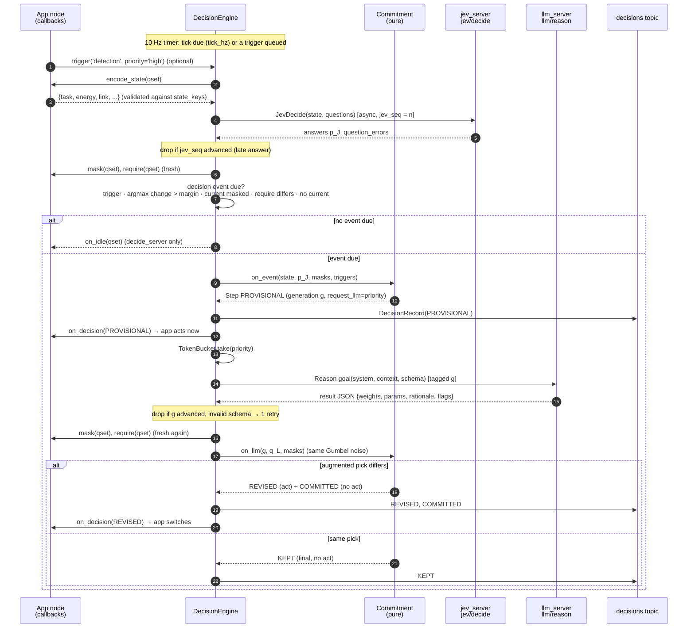

Short paths that skip the LLM:

| Condition | Phase |
|---|---|
| every selecting question is `require`d | **FORCED** (final; no models consulted for those) |
| `N_fail` consecutive Jev failures | **FALLBACK** (`on_degraded` called) |
| set has `augment: false`, or `c ≥ skip_llm_above_c`, and nothing irreversible is pending | **COMMITTED** at once |
| rate-limited, `llm_server` unavailable, goal rejected, LLM error | PROVISIONAL → **COMMITTED** (δ ≡ 0; metrics label `LLM_MISSING`) |
| `T_wait` passes with no LLM answer | PROVISIONAL → **COMMITTED**, or **FALLBACK** if an irreversible class was pending |

## 2. Commitment state machine

There is one `Commitment` per `(agent, question set)`. `generation` increments at every decision event, so a newer event silently supersedes an open one: its LLM result is discarded on arrival.

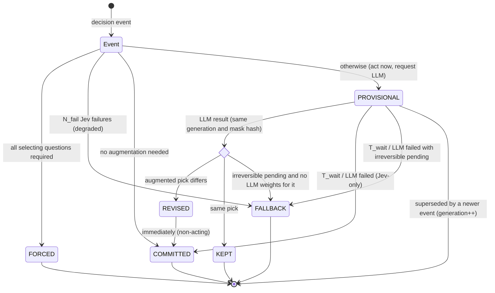

| Phase | `final` | `act` (calls `on_decision`) |
|---|---|---|
| PROVISIONAL | no | yes |
| REVISED | no | yes |
| KEPT | yes | no (only with `all_phases`) |
| COMMITTED (after PROVISIONAL or REVISED) | yes | no (only with `all_phases`) |
| COMMITTED (direct) · FORCED · FALLBACK | yes | yes |

Per-question **hold rules** sit inside selection:
- **dwell:** no voluntary switch within `T_dwell` of the last switch. A mask-forced switch is immediate.
- **committed:** an `until_commit` class past `commit_point()` is held until `completed()`. Masks, `require` and a *different* irreversible class winning the §6.4 rule still override it.

## 3. Fusion and selection pipeline (one question)

`fusion.decide_question` turns Jev's distribution and the optional LLM weights into one selected class plus a full trace.

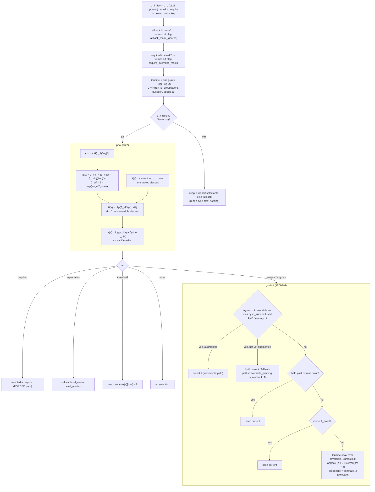

The LLM's weight is largest when Jev is **uncertain** (low c), shrinks as the advice ages, and can never move a class by more than B nats (default log 20, a 20× odds change). Only masks and `require` are absolute.

## 4. Irreversible actions

`toy_patrol`'s `halt_now` shows the three outcomes. The class is never sampled.

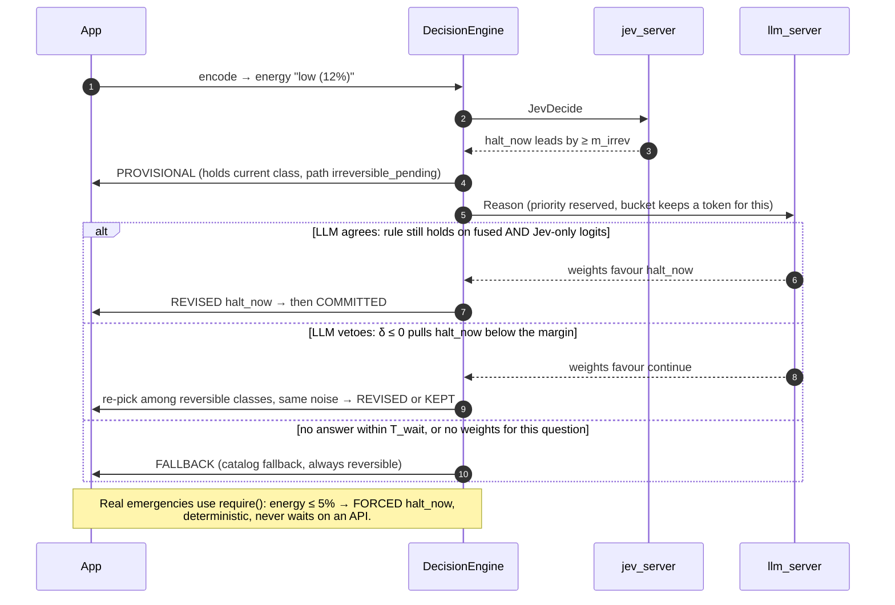

## 5. Coupled noise

Agents in one **group** coordinate without talking by sampling with shared Gumbel noise. Noise is a pure hash of logged keys, so every decision can be re-derived exactly offline.

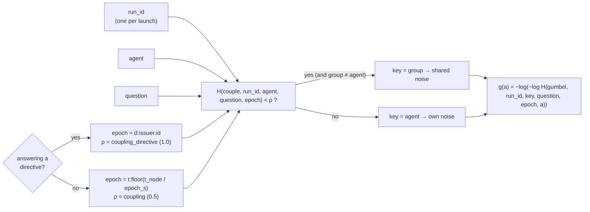

- The provisional and the augmented decision **reuse the same g**, so a revision happens only when augmentation moved the distribution enough to change the winner.
- Coupling needs a shared `run_id`. `toy_patrol.launch.py` mints one and passes it to every agent, the supervisor and `decide_server`.

## 6. LLM augmentation request

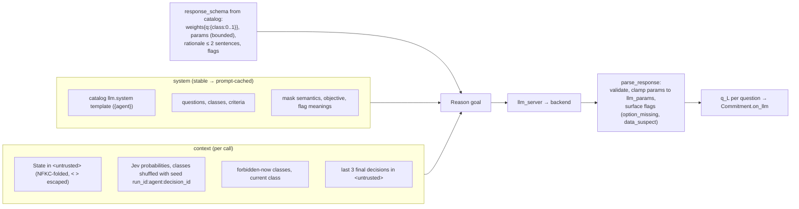

## 7. Remote decisions (C++ via decide_server)

C++ owns no decision maths. `decide_server` runs the same engine, with the goal supplying what in-process callbacks would.

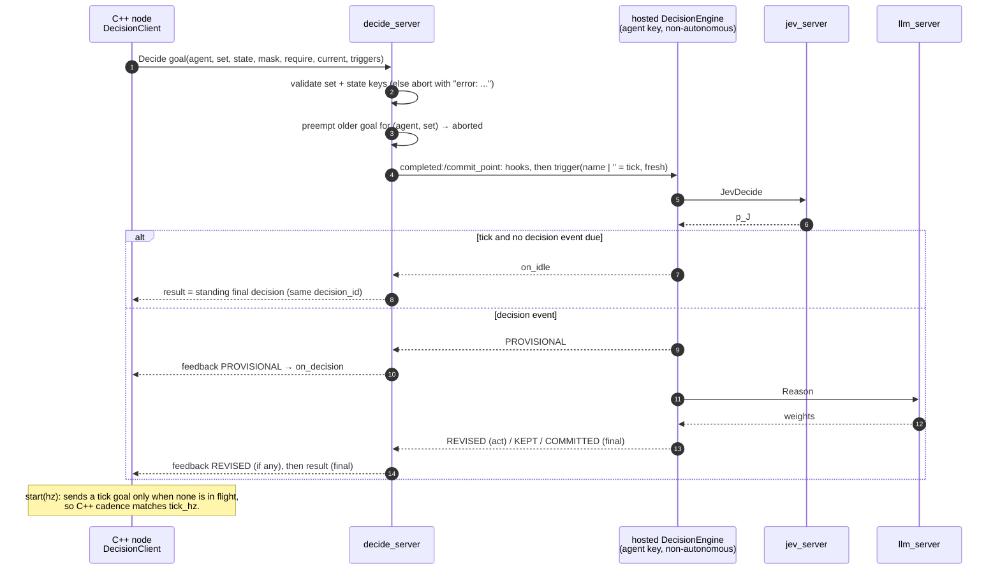

## 8. Hierarchy: reports up, directives down

This is the A7 toy: N patrol workers and one supervisor. The supervisor is itself an engine, and only its *final* `converge` is sent down.

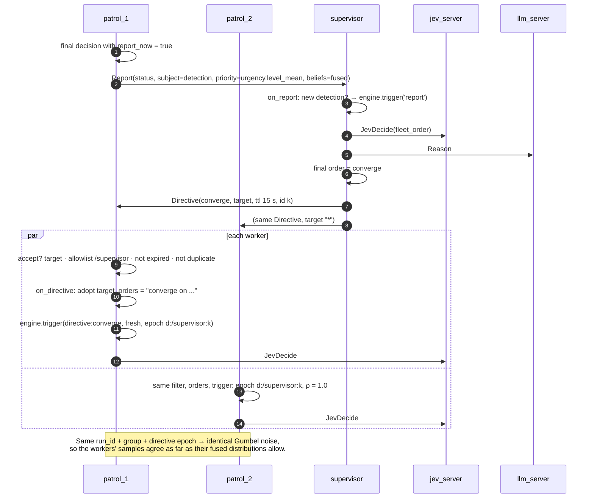

## 9. Records, metrics and replay

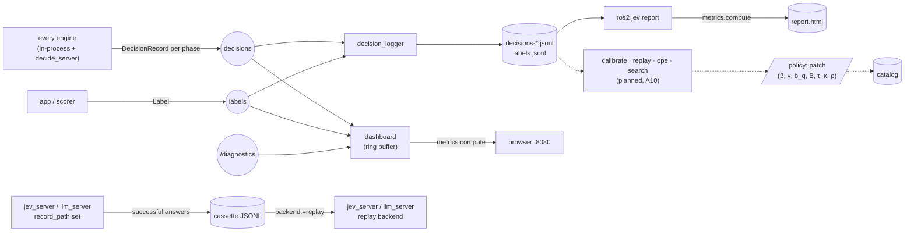

- A *decision* is all records sharing `(run_id, agent, question_set, decision_id)`, one per phase. Its outcome is read from the phase path.
- Each record carries both clocks (`header` = node clock, `wall_stamp`), the catalog and policy hashes, the models, latencies, tokens and `cost_usd`. Per question it carries `p_jev`, `q_llm`, β, masks, logits, τ, κ, **noise** and **propensity**: everything per-decision OPE needs.

## 10. Failures and degradation

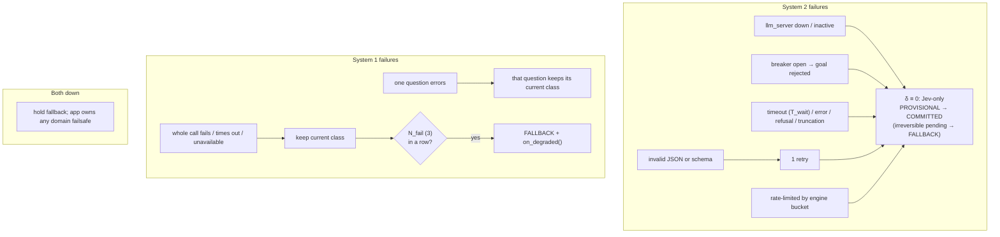

| Guard | Mechanism |
|---|---|
| Late Jev answer | `jev_seq` mismatch → dropped; Jev deadline `jev_timeout` checked by the engine timer |
| Late LLM answer | `generation` mismatch → dropped; open goal cancelled once its decision resolves |
| Masks changed while the LLM was thinking | mask hash recomputed on arrival; mismatch → dropped |
| Server-side overload | `max_rps` and `max_tokens_per_min` refuse fast; the breaker opens after 5 consecutive failures and probes after 30 s |
| Key missing for a live backend | configure FAILURE, `/diagnostics` ERROR "not configured: ... needs an API key" |

## 11. Server startup (lifecycle)

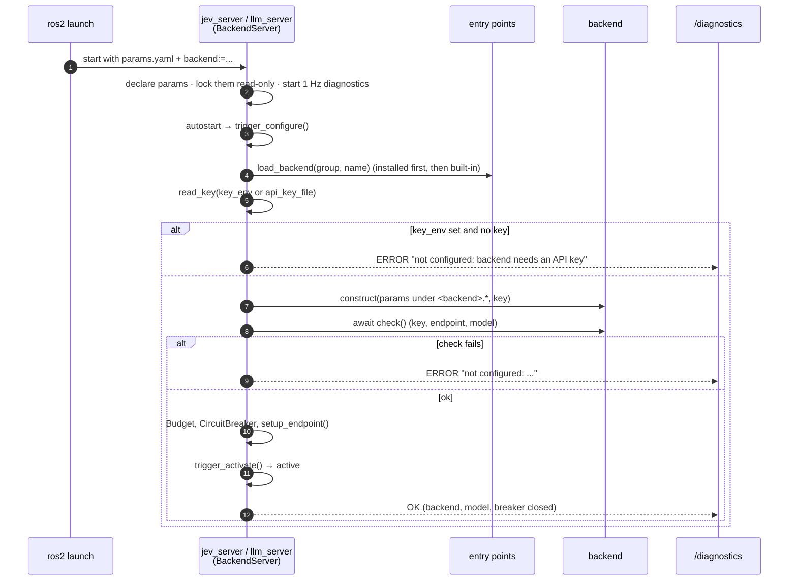

`decide_server`, `decision_logger` and `dashboard` are plain nodes. `decide_server` exits at startup if its `catalog` parameter is missing.
